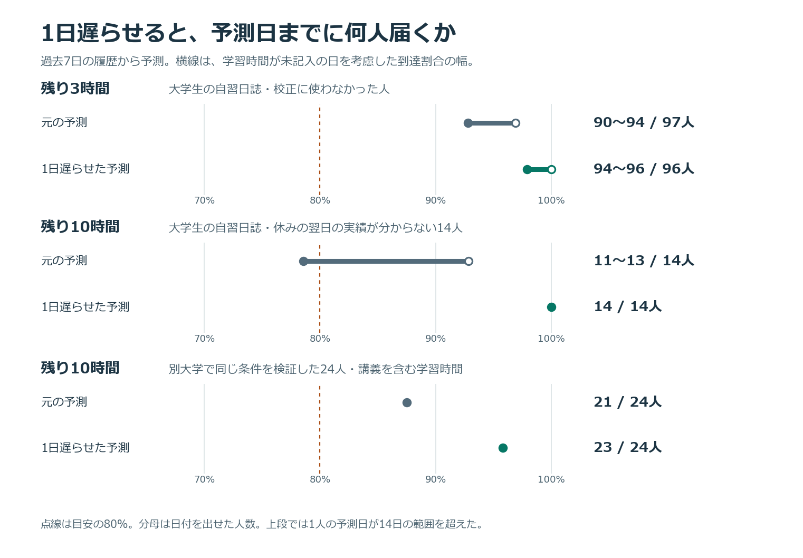

# 実際の学習日誌で「80%の確率で届く日」を検証する

大学生の自習日誌で、予測日までに残りの勉強時間を積み上げられた人数を調べた。**残り3時間では、日付を遅らせる必要は見られなかった。** 直近7日を使い、補正用と分けた131人のうち97人に日付を出せた。元の予測日までに少なくとも90人、多くて94人が届いていた（92.8〜96.9%）。一方、残り10時間で休んだ翌日の様子が分からない一部の人には、1日遅らせると見積もりが改善した。[研究Issueと結果を見る前の条件](https://github.com/FutureROI-DevTeam/Future-ROI/issues/352)

別の工科大学の日誌では、この条件を先に固定して試した。補正対象の24人のうち、早く見積もりすぎた人は3人から1人に減った。ただし元の時点で87.5%が期限内に届いていたため、遅く言いすぎた分も含む誤差は少し増えた。[別大学での検証](#別大学の154日間の学習日誌で追試)



## 日誌と参加者の分け方

- **Study longer or study effectively?** の配布日誌は245人・6,096行。夕方に申告した自習時間（時間単位の `study_time`）と、勉強したかの回答（`Testudy`）を使用した。著者が研究対象に絞った231人と、配布表の人数は異なる。[原論文](https://doi.org/10.1111/bjep.12725)・[著者の配布](https://osf.io/r9n4y/)・[変数表](https://osf.io/v2b4s/)
- **Mind the Gap!** の配布日誌は61人・1,624行。実際の自習時間は `tessh`、予定時間は `tassh`、講義時間は `tepsh`。実績には `tessh` を使った。論文の解析対象は56人。配布CSVの117行はレコード全体がもう一度引用符で囲まれており、外側を展開して読み取る。[原論文](https://doi.org/10.1026/0049-8637/a000218)・[著者の配布](https://osf.io/nzt25/)・[変数表](https://osf.io/sfra8/)
- 当初は後者を別研究の評価用とする予定だった。ところが前者の対照群（`groups=0`）と、**日別の行数・時間回答数・正の回答数・合計分数が30日すべて一致**した。そこで同じ標本として扱い、論文単位での独立追試という解釈を撤回した。照合は日別の集計のみで行った。

| 評価 | 補正幅を決める人 | 結果を見る人 |
| --- | --- | --- |
| 当初の人物分割 | 245人のうち114人 | 同じ配布表の残る131人 |
| 対照群を丸ごと除いた検証（重複発見後） | 114人から対照群26人を除いた88人 | 対照群61人。補正用88人にも対照群61人にも含まれない残る96人を、同じ補正幅で別集計 |

1人1起点。匿名の参加者番号の文字列表現に `FutureROI-study-P80-v1|longer|` を前置したSHA-256の先頭バイトが偶数なら校正、奇数なら評価に割り当てる。調査14日目の終了時に、既知の履歴7日または14日から15〜28日目を予測する。調査最終日の回答状況で対象者を絞らない。131人の評価と61人・96人の評価には重複があり、人数を合算できない。

## 何を予測し、何を数えたか

1. 残り180分（主条件）または600分（副条件）を仮の目標とする。前回の本人モデルBは、その人の記録で勉強した日の頻度と、その日に積んだ分数の分布を学ぶ。翌日以降の累積到達確率が初めて80%になる日を出す。起点日の実績が不明、正の実量が未観測、または14日以内に80%に届かない場合は日付を出せない。[本人モデル](personal.mjs)
2. 校正用の各人について「日誌と両立する一番遅い到達日 − 元の予測日」を計算する。14日を超えた結果はまとめて15番目の区分に置く。日付を出せた校正例が n 件なら、小さい順に ⌈0.8 × (n + 1)⌉ 番目のずれを採り、負なら0日とする。順位が n を超える場合、または補正後に14日を超える場合は日付を出さない。全員で求める方法と、履歴に「休み→翌日の実績が既知」という組があるかで分ける方法を比較する。各層25件未満なら全員の補正幅を使う。一律に1日遅らせる方法も評価した。[補正と評価コード](p80-calibration.mjs)・[別標本の残差で校正する方法の文献](https://proceedings.neurips.cc/paper_files/paper/2019/hash/5103c3584b063c431bd1268e9b5e76fb-Abstract.html)
3. 表の「到達人数」は、記録済みの分だけで日付までに届いた人数から、未記入日に勉強していた場合に届き得る人数までの幅。標本誤差は含まない。日付の取り下げを別に数える。これとは別に、早すぎた1日に0.8、遅すぎた1日に0.2の損失を付ける。元の日付を出せた全員を対象に、同じ人・同じ実現可能な到達日について補正前後の差を取る。期間外を15として打ち切った分位損失であり、正の差は悪化を表す。[分位点と損失の関係](https://doi.org/10.1016/j.ijforecast.2009.12.015)

## 休みの回答を使った主分析

自習時間の正値は分に四捨五入（最小1分）。明記された0時間と、時間欄が空でも勉強しなかったという回答がある日は0分。行の欠落、未回答、休みと正時間の矛盾、不誠実という回答（`TEKontroll=3` がある配布のみ）、15時間以上・負の報告は不明とした。全日程のうち観測できた日は大きい配布表で5,950日（0分2,068日）、対照群の配布表で1,621日（0分561日）。同じ人・日付の重複は両方とも0件。

| 評価 | 履歴 | 残量 | 元の日付の発行人数 | 元の日付までの到達人数 | 履歴で分けて補正した後の到達人数 |
| --- | ---: | ---: | ---: | ---: | ---: |
| 人物分割・131人 | 7日 | 3時間 | 97 | 90〜94 | 90〜94 |
| 同上 | 7日 | 10時間 | 82 | 78〜81 | 78〜81 |
| 同上 | 14日 | 3時間 | 99 | 95〜99 | 95〜99 |
| 同上 | 14日 | 10時間 | 85 | 76〜80 | 76〜80 |
| 対照群・61人 | 7日 | 3時間 | 50 | 48 | 48 |
| 同上 | 7日 | 10時間 | 44 | 40〜42 | 41〜42 |
| 同上 | 14日 | 3時間 | 53 | 49〜50 | 49〜50 |
| 同上 | 14日 | 10時間 | 44 | 37〜39 | 37〜39 |

表の補正で日付の取り下げは0件。人物分割では全条件で0日の補正を学んだ。主条件で日付が出なかった34人の内訳は、起点日不明30人、正の学習量なし2人、14日以内に80%に達しない2人。対照群では11人に日付が出なかった。このため、97人中90〜94人という割合を全131人の精度としては使えない。

主条件で一律に1日遅らせると、人物分割では94〜96人／96人が届いたが、1人の日付が14日を超え、分位損失は平均0.128〜0.169悪化した。対照群でも48人／50人が49人／50人になる一方で損失は0.160悪化した。また、活動日誌PMDataで早い見積もりが見られた「休みの翌日の実績を観測できない」層は、対照群の14日履歴で、残り3時間・10時間とも3人／4人。両条件の4人は同じである。[活動日誌での先行比較](followup.md#pmdataでの独立確認)

## 未記入と休みの区別を変えた追加分析

大きい配布表には時間欄が空の休み回答が1,829行ある。うち773行では夕方の達成感・ストレス・落ち着き・活力の4項目もすべて空欄だった。そこで結果確認後に、時間が空ならすべて不明にする方法と、夕方4項目のどれかが記入された休みだけを0分にする方法で、校正・評価の両方をやり直した。回答の有無だけを使う。以下の3行は参加者の範囲と、欠測が許す実際の到達日の幅も異なる。

| 対照群・7日履歴・残り10時間 | 補正前に届いた人数／発行人数 | 履歴で分けて補正した後 | 取り下げ | 分位損失の差 |
| --- | ---: | ---: | ---: | ---: |
| 配布表の休み回答を使う（主分析と同じ扱い） | 40〜42／44 | 41〜42／44 | 0 | +0.082〜+0.127 |
| 時間の数値がある日のみ使う | 30〜41／41 | 35〜41／41 | 0 | −0.068〜+0.200 |
| 夕方の回答がある休みを使う | 36〜39／41 | 39／40 | 1 | +0.215〜+0.288 |

**1日の補正で改善した例**は、最後の行のうち休みの翌日の実績がない14人。元の日付で11〜13人、1日遅らせると14人全員が届いた。取り下げはなく、同じ日誌上で早すぎた日付を1〜3人分解消した。この層について校正用データから学んだ3日の補正でも14人全員だったが、分位損失は元より0.386〜0.529悪化した。1日補正の差は−0.014〜+0.129で、改善・悪化の両方が残った。

その14人を含まない96人で同じ条件を見ると、日付を出せた該当者は21人。元の期限で18〜21人、1日遅らせて19〜21人、取り下げ0人。早すぎた日付を解消した人数は0〜3人で、分位損失は0.057〜0.200悪化した。この結果から、別大学に持ち込む条件を「残り10時間で、休んだ翌日の実績が一度も分からない場合だけ1日足す」と固定した。

## 別大学の154日間の学習日誌で追試

Liborius・Bellhäuser・Schmitzが工科大学で収集した105人・154日の日誌を使用した。`time_use` は自習と講義出席を合わせた時間で、時間単位の小数を分に換算した。多研究論文のStudy 2として公開された配布表には全員の全調査日（0〜153）があり、無回答日にも時間欄に0が入っている。著者の判定式どおり、時間と他の6項目の合計が欠測を除き0になる1,198日を不明とした。15時間以上の26日も不明とした。結果、16,170日のうち実績既知14,946日、うち0分6,028日。全期間の回答率を使った除外は行わず、105人全員を発行率の分母にした。[原論文](https://doi.org/10.1016/j.learninstruc.2017.10.006)・[多研究論文のTable 1](https://doi.org/10.1016/j.cedpsych.2023.102208)・[Study 2のデータ](https://osf.io/download/8sxd7/)・[著者の欠測判定コード](https://osf.io/download/a8c4u/)

105人の結果を見る前に、上記の1日補正と起点をIssueに記録した。この大学では再学習していない。残り10時間について、左の3列は日付を出せた全員、右の3列はそのうち補正対象になった人の結果を示す。

| 履歴・起点 | 日付発行／105人 | 全員の到達人数（元 → 補正） | 補正した人数 | その人の到達人数（元 → 補正） | 補正対象の分位損失差 |
| --- | ---: | ---: | ---: | ---: | ---: |
| 7日・調査14日目 | 80／105 | 73 → 75 | 24 | 21 → 23 | +0.075 |
| 14日・調査14日目 | 81／105 | 74 → 74 | 17 | 15 → 15 | +0.082 |
| 28日・調査28日目 | 91／105 | 82〜84 → 82〜84 | 6 | 5 → 5 | +0.033 |

7日履歴では1日遅らせて**2人の早すぎる日付を解消**し、取り下げは0件。元から21人／24人は期限内で、残り3人のうち1人は補正後の期限も過ぎた。最初から間に合う21人にも1日ずつ余裕を加えたため、24人の平均分位損失は0.075悪化した。14日・28日履歴では期限に間に合う人数が増えなかった。参考の残り3時間は補正対象外で、7日履歴84人／87人、14日83〜84人／89人、28日88〜89人／95人が元の期限までに届いた。同じ学生を履歴長ごとに足し合わせることはできない。

## 再実行

リポジトリのNode 24.22.3、R 4.4.1の標準パッケージで確認した。実験は著者が研究用に公開した配布ファイルをローカルで読む。OSFのライセンス欄は両プロジェクトとも未指定。ここには分析コードと集計・図のみを収録した。[大きい配布表](https://osf.io/download/xuw8r/)・[対照群の配布表](https://osf.io/download/3v8gb/)

リポジトリルートで `npm ci` と `npm run build:prediction` を実行する。`Rscript` をPATH上に置くか、環境変数 `RSCRIPT` に実行ファイルのパスを設定する。各コマンドの `path/to/...` を対応するダウンロード先に置き換える。

```sh
node --test experiments/variable-amount-forecast/study-p80.test.mjs
node experiments/variable-amount-forecast/study-p80.mjs path/to/data.RData path/to/data.csv
node experiments/variable-amount-forecast/study-p80.mjs path/to/data.RData path/to/data.csv --recorded-hours-only
node experiments/variable-amount-forecast/study-p80.mjs path/to/data.RData path/to/data.csv --evening-response
node experiments/variable-amount-forecast/study-p80.mjs --liborius path/to/data_project2.RData
```

入力のSHA-256を[Rへの読み込み前に検証](study-p80.mjs)する。最初のRDataは `a1ca29477341999aaa58fea1c216e29acb9407d1c976f7d2aac8137873dc24af`、CSVは `64c9e5a724912cdd0234e69d7d481ae1be376b0ffff54cd10b41e9e1d31c14e7`、工科大学のRDataは `5f7449d85ba0cace37f82e4895a4f0138e086b153a27d163085643c65ca2499c`。JSONには参加者分割、欠測・発行の理由、補正幅、到達人数の上下限、同じ人の損失差が出る。上図の上段は主条件の `holdout.all`、中段は `--evening-response`・7日・600分の `control.noRestFollowed`、下段は `--liborius`・7日・600分の `noRestFollowed` を使用した。

## 適用できる範囲

対象は大学生の自己申告で、一方は試験前の自習、もう一方は自習と講義を合わせた学習時間。3時間・10時間は研究上の仮の残量で、製品利用者自身が設定した目標の到達日や、中断後の再開時期の予測は未検証。発行率、欠測、少人数の層があるため、個人に対する80%保証は導けない。一律の標準補正を支持する結果は得られなかった。次の検証対象は「早すぎた人」と「すでに間に合っていた人」を発行時点の記録でさらに見分けられるかである。
